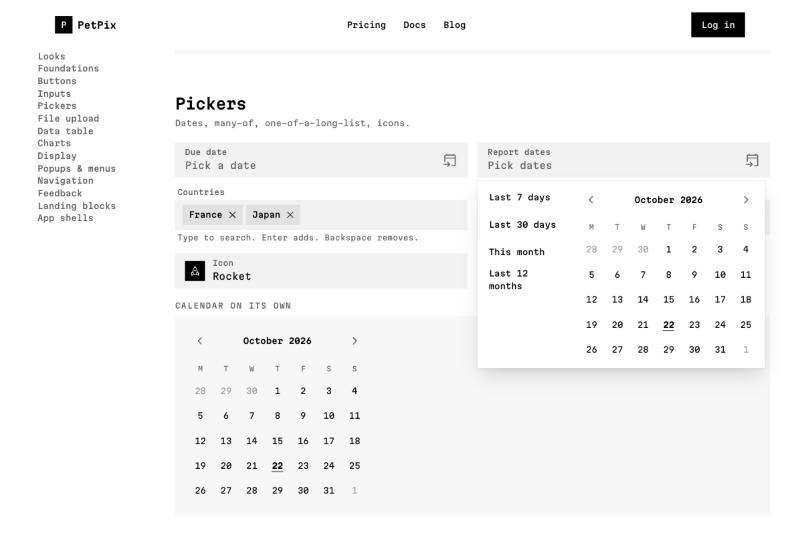
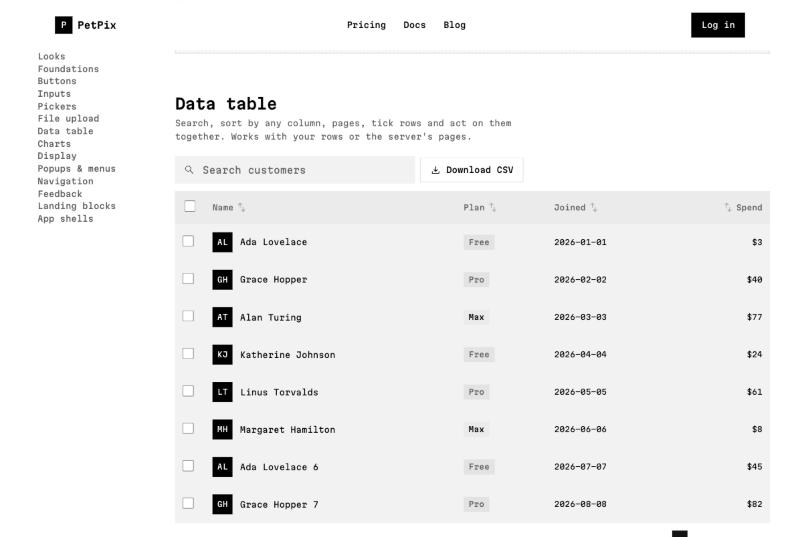

# AMNT UI: Ink

**A free design system for Next.js + Tailwind: 50+ parts, phone first, light and dark, no component library underneath.**

Black and white. Square corners. One font. Your content is the colour.





---

## ✅ What's inside

| Group | Parts |
| --- | --- |
| **Buttons** | Button (filled, tonal, elevated, outlined, text, danger), IconButton, Fab, Chip, ChipGroup |
| **Inputs** | TextField, Textarea, Select, Search, Checkbox, Radio, Switch, Slider, SegmentedButton, CodeInput (6-digit codes), ColorField, ColorPicker |
| **Pickers** | DatePicker, DateRangePicker (with quick picks), Calendar, MultiSelect (tags), Combobox, IconPicker |
| **Upload** | FileUpload: drop, click or paste, progress per file, type and size checks |
| **Data** | DataTable (search, sort, pages, row picks, bulk actions, server mode), Table, List, Pagination |
| **Charts** | LineChart (area), BarChart (grouped or stacked), DonutChart, Sparkline, Metric: plain SVG, no chart library |
| **Popups** | Menu (with sub-menus and right-click), Popover, Sheet (bottom on phones), Window, CommandMenu (⌘K), Tooltip, Toast, confirm dialog, NotificationBell |
| **Navigation** | Tabs, Breadcrumb, Steps, Accordion, NavigationBar, NavigationRail, NavigationDrawer |
| **App shells** | SidebarShell (folds to icons, slides in on phones), TopbarShell, plus 6 page layouts |
| **Feedback** | Alert, Banner, EmptyState, Skeleton, Progress, Spinner, Status, Badge |
| **People** | Avatar, AvatarGroup, Person |
| **Foundations** | Colour roles (light + dark), type scale, shapes, motion, 339 Material Symbols icons |

Every part:
- works with the **keyboard**
- has **screen-reader** labels
- has **48 px touch targets**
- uses **colour roles, never fixed colours**

So dark mode and your own brand colour come for free.

---

## 🚀 Install

### 1. One command (any project, any agent)

```bash
npx shadcn@latest add https://raw.githubusercontent.com/BelgacemElbar/amnt-ui/main/public/r/ink.json
```

The parts land in `src/ui`, plus `tailwind.preset.ts`. Then:

1. **Tailwind:** in `tailwind.config.ts`, add `presets: [ink]` (`import ink from "./tailwind.preset"`).
2. **CSS:** at the top of `globals.css`:
   ```css
   @import "../ui/tokens/tokens.css";
   @import "../ui/tokens/legacy.css";
   @import "../ui/ui.css";
   ```
3. **Paths:** `tsconfig.json` needs `"@/*": ["./src/*"]` (Next.js has it by default).
4. **Use it:** `import { Button, DataTable, DatePicker } from "@/ui"`.

### 2. Claude Code plugin

```bash
claude plugin marketplace add BelgacemElbar/amnt-ui
claude plugin install amnt-ui@amnt
```

Then just ask: *"add a settings page with a data table and a date range picker"*. Claude knows the parts and the rules.

### 3. Copy the folder

Copy `ui/` to `src/ui` and `tailwind.preset.ts` to your project root, then do steps 1–4 above.

---

## 🎨 Figma

The tokens are in `figma/`, in the standard design-token format (DTCG):

| File | Holds |
| --- | --- |
| `light.tokens.json` | 49 colour roles, light |
| `dark.tokens.json` | the same roles, dark |
| `base.tokens.json` | spacing, corners, type sizes |

**Import them** with Figma's variable import (or the Tokens Studio plugin):
1. Make one collection, **Ink**, with two modes: **Light** and **Dark**.
2. Import `light.tokens.json` into Light and `dark.tokens.json` into Dark.
3. Import `base.tokens.json` into a second collection.

Rebuild them after changing tokens: `node scripts/figma-tokens.mjs`.

---

## 🤖 For agents

- **[AGENTS.md](AGENTS.md):** the rules every part follows, and how to add one.
- **[llms.txt](llms.txt):** a short map of the whole system, for any AI.

---

## 💼 Want the whole product?

AMNT UI is the free design layer. **[AMNT Ship Kit](https://amnt.io)** is the paid, finished SaaS built on it. You rename it and launch. It adds:
- sign-in and two-step sign-in
- Stripe payments with a Balance
- teams with roles
- an admin panel
- six languages
- 21 looks
- a dashboard
- landing pages, a blog, docs and legal pages

---

## 📜 Licence

MIT. Use it in anything, free or paid. Copyright © 2026 AMNT.IO LTD.

Icons: Material Symbols (Apache 2.0, Google). Font: Martian Mono (SIL OFL 1.1, Evil Martians).
